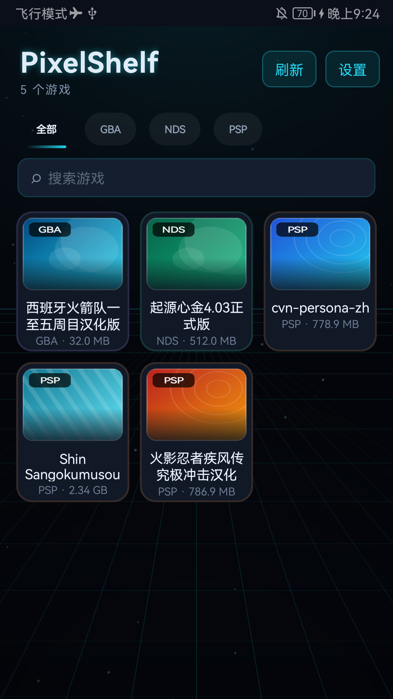
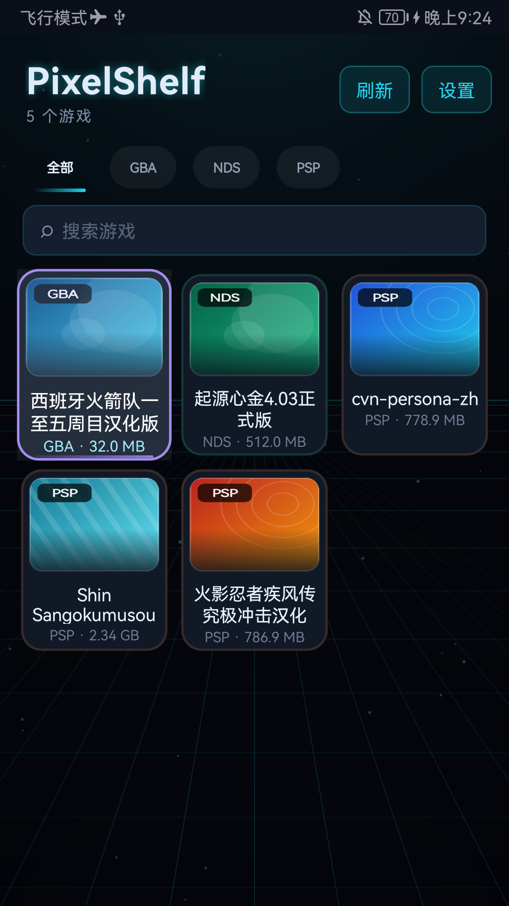

# PixelShelf

A lightweight Android game-library frontend that unifies **8 platforms** (GBA, GBC/GB, NDS, PSP, SNES, NES, Genesis/MD, PS1) into one launcher — so you open one app and pick any game, instead of juggling a dozen emulator icons.

Built for Chinese ROM collections: works with fan-translated and ROM-hack releases that English-first scrapers can't match.




> 中文说明见 [README.md](README.md)

## Why another frontend?

| | PixelShelf | Typical frontends |
|---|---|---|
| APK size | **~410 KB** | 30–100 MB |
| Dependencies | **none** (no AndroidX, no Gradle plugins) | Kotlin + AndroidX + Coil + Room… |
| Cover matching | reads **ROM internal title** (`PARAM.SFO`, cartridge headers) + Chinese alias table | matches English filenames only |
| Works offline | yes, index is embedded | often needs online scraping |
| ROM hacks | detects and labels them (`改版` badge) | usually mismatched |

## Features

- **Unified library** — scans `ROM/`, `Download/`, `MyBoy/`, `DraStic/`, `PSP/` and other common folders
- **8 platforms** — GBA, GBC/GB, NDS, PSP, SNES, NES, Genesis/MD, PS1
- **One-tap launch** — hands the ROM to the right emulator automatically (My Boy!, DraStic, PPSSPP, RetroArch, mGBA, melonDS, ePSXe…)
- **Automatic covers** — matched offline from a bundled index, downloaded once and cached forever
- **Hack-aware** — knows that `西班牙火箭队` is a Pokémon Emerald hack and shows the base-game cover with a `改版` badge
- **Gamepad-friendly** — D-pad to move focus, A to launch, B for search, L1/R1 to switch platform
- **Cyberpunk UI** — animated perspective grid, procedural covers as fallback, focus glow/scale animations, all custom-drawn
- **Landscape aware** — 3–4 columns in portrait, up to 8 in landscape with a compact header; reflows live on rotation
- **Boot start** — optional autostart so it behaves like a handheld console's home screen
- **Huawei/Honor aware** — detects the OEM restriction on third-party launchers and offers a workaround instead of silently failing

## Install

1. Download `PixelShelf.apk` from [Releases](../../releases) and install it (allow unknown sources).
2. Grant "All files access" on first launch — required to scan ROM folders.
3. Optionally set it as your default home app (Settings → 桌面与启动).

Requires Android 5.0+ (API 21).

## Supported platforms

| Platform | Extensions | Known emulators |
|---|---|---|
| GBA | `.gba` | My Boy!, GBA.emu, Pizza Boy, mGBA, RetroArch |
| GBC / GB | `.gbc` `.gb` | My OldBoy!, GBC.emu, My Boy!, Pizza Boy, RetroArch |
| NDS | `.nds` `.ds` | DraStic, melonDS, NDS.emu, RetroArch |
| PSP | `.iso` `.cso` `.pbp` `.chd` | PPSSPP, PPSSPP Gold, RetroArch |
| SNES | `.sfc` `.smc` `.swc` | Snes9x EX+, SuperRetro16, Nostalgia.SNES, RetroArch |
| NES | `.nes` `.fds` `.unf` `.unif` | NES.emu, Nostalgia.NES, RetroArch |
| Genesis / MD | `.md` `.gen` `.smd` | MD.emu, RetroArch |
| PS1 | `.cue` `.ccd` `.m3u` | ePSXe, DuckStation, FPse, RetroArch |

PS1 intentionally avoids `.iso`, `.pbp` and `.chd` because those extensions collide with PSP; disc images with `.cue` are detected reliably.

Zipped ROMs (`.zip`/`.7z`/`.rar`) are resolved by keywords in the filename, e.g. `Pokemon GBA.zip`.
Emulator system files (`*bios*`, `*firmware*`, `*cheat*`) and suspiciously small archives are ignored.

## Build from source

No Gradle required — the build is a plain `aapt2` + `javac` + `d8` + `apksigner` pipeline.

```powershell
# 1. (optional) generate the cover index once — needs network
python build_index.py

# 2. build
powershell -ExecutionPolicy Bypass -File .\build.ps1
```

Requires Android SDK build-tools 35, platform android-35, and JDK 21.
Set `ANDROID_HOME` / `JAVA_HOME` if they are not in the default locations.

Signing: a throwaway keystore is generated automatically if none exists.
For reproducible releases, provide `PIXELSHELF_KEYSTORE`, `PIXELSHELF_KS_ALIAS`,
`PIXELSHELF_KS_PASS`, `PIXELSHELF_KEY_PASS` through environment variables.

## Project layout

```
app/src/main/
  java/com/pixelshelf/app/
    MainActivity.java     library UI, D-pad navigation, cover fetching
    SettingsActivity.java settings screen
    Scanner.java          recursive ROM discovery
    Emulators.java        emulator package table + extension mapping
    Launcher.java         intent dispatch (incl. PPSSPP Args special case)
    RomHeader.java        reads GBA/NDS headers and PSP PARAM.SFO
    CoverMatch.java       fuzzy matching + Chinese alias table
    CoverFetcher.java     download + cache + hack detection
    CoverArt.java         procedural cover generator (offline fallback)
    TechBackground.java   animated cyber grid background
  res/                    layouts, drawables, icons
build.ps1                 offline build script
build_index.py            regenerates the cover name index
```

## Legal

This project ships **no games, no emulators, no BIOS files and no cover art**.

- It is a launcher only; you must own your ROMs and install the emulators yourself.
- Cover images are downloaded on demand from a public thumbnail library and cached locally. You can disable this in Settings.
- Not affiliated with Nintendo or Sony. Platform names are used only to describe compatibility.

See [NOTICE.md](NOTICE.md) for third-party attributions, and [LICENSE](LICENSE) (MIT).

## Being a good citizen of the cover source

The default cover source is a free public service run by a third party. PixelShelf:

- sends requests **serially**, at least **1.2 s apart**
- never re-downloads an already cached cover
- backs off on `429` / `503` according to `Retry-After` and gives up for that round
- identifies itself in the `User-Agent`
- lets you **replace the source** with your own mirror (Settings → 封面与网络), https only

If you plan to use this at scale, please host your own mirror.


## Contributing

Issues and PRs are welcome. Two things worth knowing before you start:

- The project intentionally avoids AndroidX and third-party libraries. Keep new code on the framework APIs.
- `build.ps1` is the canonical build path; keep it working as well as any new build files.

## FAQ

**Why can't PixelShelf become my default home app on Huawei/Honor?**
EMUI/MagicOS blocks third-party launchers for non-system apps. The app detects this and offers "boot autostart + desktop shortcut" as a workaround.

**A game launches to a black screen on PPSSPP.**
PPSSPP does not accept `file://` URIs. PixelShelf special-cases it by passing `org.ppsspp.ppsspp.Args` with an absolute path.

**My game has no cover.**
The public library does not contain every title. Long-press the card → 「搜索封面…」 to search the offline index, or drop your own image named after the ROM next to it.
