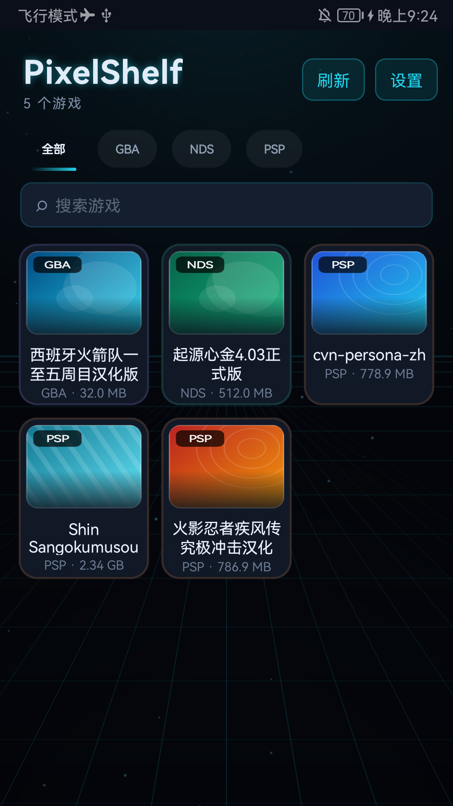
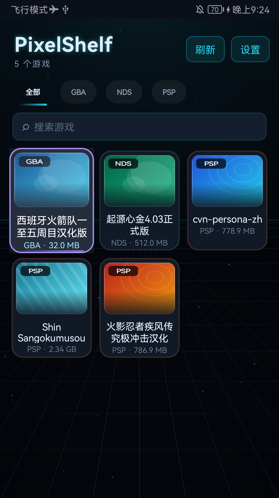

# PixelShelf

把 GBA / GBC / NDS / PSP / SNES / NES / MD / PS1 八个平台的模拟器游戏集中到一个界面，点开就玩，并可设为开机桌面。
界面参考开源掌机前端（EmulationStation / ES-DE）风格：赛博网格背景、官方封面、聚焦缩放与辉光动效。

> English: [README.en.md](README.en.md) ｜ 许可：[MIT](LICENSE) ｜ 声明：[NOTICE.md](NOTICE.md)




## 安装

1. 把 `PixelShelf.apk` 传到手机，点击安装（需允许「安装未知来源应用」）。
2. 首次打开会要求「所有文件访问」权限，授予后才能扫描到 ROM。

## 用法

- 顶部标签：全部 / GBA / NDS / PSP 筛选；搜索框可搜游戏名。
- 点任意游戏：自动用对应的模拟器打开。
- 长按任意游戏：搜索/更换封面、清除封面。
- 右上「刷新」重新扫描，「设置」进入配置。

### 手柄 / 方向键

| 按键 | 作用 |
|---|---|
| 方向键 | 在卡片间移动焦点（卡片会放大并亮起平台色描边） |
| A / 回车 / 确认 | 启动当前选中的游戏 |
| B | 回到搜索框（设置页里是返回） |
| L1 / R1 | 快速切换平台标签 |

## 界面特性

- **赛博网格背景**：透视网格向上流动 + 漂浮粒子 + 顶部辉光，纯 Canvas 绘制
- **程序化封面**：按游戏名哈希稳定生成渐变配图，同一游戏永远是同一张封面，无需联网抓图
- **动效**：卡片入场淡入上浮、平台切换错峰动画、聚焦缩放 + 平台色描边 + 底部光条、按压回弹、标题辉光呼吸
- **平台配色**：GBA 紫 / NDS 绿 / PSP 橙，标签、描边、光条保持一致
- **横竖屏自适应**：竖屏 3~4 列，横屏自动压缩顶部栏、卡片变扁、最多 8 列，旋转时实时重排不重启

## 网络封面

应用会自动从 [libretro thumbnails](https://thumbnails.libretro.com/) 抓取官方封面（免费、无需 API key），抓到后永久缓存到本地，之后完全离线可用。

**怎么做到中文汉化版也能匹配**

1. **读 ROM 内部官方标题**：GBA 读 0xA0、NDS 读 0x00 的头部标题；PSP 解析 ISO9660 找到 `PSP_GAME/PARAM.SFO` 里的 `TITLE`
2. **中文别名展开**：内置 100+ 组中文→英文映射（心金→HeartGold、战神→God of War、火影忍者→Naruto 等），把中文文件名转成英文关键词
3. **索引离线模糊匹配**：libretro 的 16,594 条封面名索引（约 780 KB）已打包进 APK，运行时本地比对，无需下载索引

**以后加入新游戏**：放进 ROM 文件夹 → 点「刷新」，应用会自动匹配并下载封面，无需任何手动操作。

### 魔改 / 汉化版

魔改版是在原版 ROM 上改的，内部头部通常还是原版，所以会自动拿到**原版游戏的封面**。卡片右上角会显示「改版」标记，说明这是原版的图。

长按卡片可以看到具体的封面来源，例如：

```
西班牙火箭队一至五周目汉化版
封面来自：Pokemon - Emerald Version (USA, Europe)（原版游戏）
```

判断规则：只看文件名与中文别名是否指向原版。指向原版的（如「起源心金」→ HeartGold、「火影忍者」→ Naruto）不加标记；完全对不上的（如「西班牙火箭队」）才标「改版」。

**手动干预**（长按任意游戏卡片）：

| 菜单项 | 作用 |
|---|---|
| 搜索封面… | 输入英文名，从本地索引挑选（离线可搜），点选后下载 |
| 重新自动获取封面 | 清除缓存后重新匹配 |
| 清除封面 | 恢复程序化封面 |
| 用其他模拟器打开 | 换一个模拟器启动 |

**自己放封面**：把图片命名成和 ROM 同名（`.png` / `.jpg`），放在 ROM 同目录或 `covers/` 子目录，优先级最高。

**缓存位置**：`Android/data/com.pixelshelf.app/files/covers/`，可以直接查看和替换。

> 注：libretro 图库并非包含所有游戏（例如《真三国无双6 Special》就没有），这类游戏需要手动搜索或自行放图。


## 设置

- **设为默认桌面**：点一下会跳到系统的「主屏幕」设置，选择「PixelShelf」。之后按 Home 键或开机都会回到PixelShelf。想换回去，在同一个地方选回原桌面即可。
  - ⚠️ **华为 / 荣耀手机不支持**：EMUI 移除了第三方桌面选择入口，应用会提示并给出替代方案。
- **开机自启动**：不设为桌面时也能开机弹出PixelShelf。华为机型还需在「应用启动管理」里允许本应用自启动（设置页有一键跳转按钮）。
- **游戏文件夹**：建议把 ROM 集中放一个文件夹后添加进来；留空则自动扫描常见目录（Download、roms、MyBoy、DraStic、PPSSPP 等）。
- **模拟器**：每种平台会列出设备上已安装的模拟器，点一下即可指定用哪个打开。未指定时按主流包名自动匹配。

## 模拟器兼容性说明

| 模拟器 | 启动方式 |
|---|---|
| My Boy!（GBA） | 标准 `ACTION_VIEW` + file URI |
| DraStic（NDS） | 标准 `ACTION_VIEW` + file URI |
| PPSSPP（PSP） | **专用 `org.ppsspp.ppsspp.Args` extra**（PPSSPP 不解析 file:// URI） |

PPSSPP 对 `file://` URI 会报「文件不存在」，应用已针对它改用自身的参数通道，实测可以进入游戏。


## 支持的平台与模拟器

| 平台 | 后缀 | 自动识别的模拟器 |
|---|---|---|
| GBA | `.gba` | My Boy!、GBA.emu、Pizza Boy、mGBA、RetroArch |
| GBC / GB | `.gbc` `.gb` | My OldBoy!、GBC.emu、My Boy!、Pizza Boy、RetroArch |
| NDS | `.nds` `.ds` | DraStic、melonDS、NDS.emu、RetroArch |
| PSP | `.iso` `.cso` `.pbp` `.chd` `.elf` | PPSSPP、PPSSPP Gold、RetroArch |
| SNES | `.sfc` `.smc` `.swc` | Snes9x EX+、SuperRetro16、Nostalgia.SNES、RetroArch |
| NES | `.nes` `.fds` `.unf` `.unif` | NES.emu、Nostalgia.NES、RetroArch |
| MD（世嘉） | `.md` `.gen` `.smd` | MD.emu、RetroArch |
| PS1 | `.cue` `.ccd` `.m3u` | ePSXe、DuckStation、FPse、RetroArch |

列表里没有你的模拟器也能用：只要它能响应打开对应 ROM 文件，就会被自动选中。设置页也可以手动指定。

**为什么 PS1 只认 `.cue`/`.ccd`/`.m3u`**：`.iso`、`.pbp`、`.chd` 与 PSP 的后缀完全重叠，按后缀无法区分。带 `.cue` 的 PS1 镜像可以直接识别；单文件 `.chd`/`.pbp` 目前会归到 PSP。

**其他后缀**：`.zip` `.7z` `.rar` 按文件名关键词识别平台（如 `Pokemon GBA.zip`）。

游戏名会自动去掉 `(USA)`、`(Rev 1)`、`[!]` 这类标签。模拟器的系统文件（`*bios*`、`*firmware*`、`*cheat*`）和体积异常小的压缩包会被自动排除。

## 说明

- 应用不包含任何游戏，只做索引和启动。
- 需要 Android 5.0 及以上。
- 若某个游戏点开没反应，去设置里手动指定该平台的模拟器。

## 实机验证记录

已验证设备：华为 VTR-AL00（Android 9，EMUI）

| 项目 | 结果 |
|---|---|
| 安装 / 签名 | ✅ 通过 |
| 扫描 ROM（/sdcard/ROM，7 个游戏） | ✅ 全部识别，平台与中文文件名正确 |
| GBA → My Boy! | ✅ 进入游戏标题画面 |
| NDS → DraStic | ✅ 进入游戏画面 |
| PSP → PPSSPP | ✅ 进入游戏开场（修复后） |
| 开机自启动开关 | ✅ 开关状态持久化 |
| 新界面渲染 / 方向键聚焦 / 平台筛选 | ✅ 均正常 |
| 设为默认桌面 | ❌ 华为系统限制，已在应用内提示并给替代方案 |

## 构建

`build.ps1` 直接用 Android SDK 的 `aapt2` + `javac` + `d8` + `apksigner` 构建，不依赖 Gradle 或联网下载依赖：

```powershell
# 1.（可选，需要联网）生成封面索引
python build_index.py

# 2. 构建
powershell -ExecutionPolicy Bypass -File .\build.ps1
```

需要 Android SDK build-tools 35、platform android-35、JDK 21。
不在默认路径时设置 `ANDROID_HOME` / `JAVA_HOME` 环境变量。

产物为 `PixelShelf.apk`。签名可通过 `PIXELSHELF_KEYSTORE` / `PIXELSHELF_KS_ALIAS` /
`PIXELSHELF_KS_PASS` / `PIXELSHELF_KEY_PASS` 环境变量指定；未指定时会自动生成一个
本地一次性 keystore（已被 `.gitignore` 排除，**不会**提交到仓库）。

## 开源与合规

- 许可证：[MIT](LICENSE)
- 第三方资源与法律声明：[NOTICE.md](NOTICE.md)
- English README: [README.en.md](README.en.md)

**本项目不包含**：任何游戏 ROM、任何模拟器程序或代码、BIOS/固件、任何游戏封面图片、
签名密钥。应用只是一个启动器，需要用户自行安装模拟器并自备合法获得的 ROM。

**关于封面**：应用运行时按游戏名从公开图库按需下载封面并仅缓存到本机，不分发不打包。
可在「设置 → 封面与网络」中关闭自动获取，关闭后应用完全不联网。

对图源服务采取的友好措施：

- 请求**串行**发送，两次请求间隔至少 **1.2 秒**
- 已缓存的游戏**不会重复下载**
- 收到 `429` / `503` 时按 `Retry-After` 退避，本轮直接放弃，不重试刷屏
- User-Agent 标明应用名与版本，方便对方识别与限流
- 图源可在设置中**替换为自建镜像**，需保持 `<平台目录>/Named_Boxarts/<游戏名>.png` 结构；出于安全只接受 `https://`

**关于商标**：与任天堂、索尼等权利人无任何关联；界面与代码中出现的平台名称
仅用于说明兼容性。详见 [NOTICE.md](NOTICE.md)。

**隐私**：无广告、无统计埋点、无账号系统，不收集任何个人数据；
`android:allowBackup="false"`，禁用明文 HTTP，仅使用 HTTPS 下载封面。


